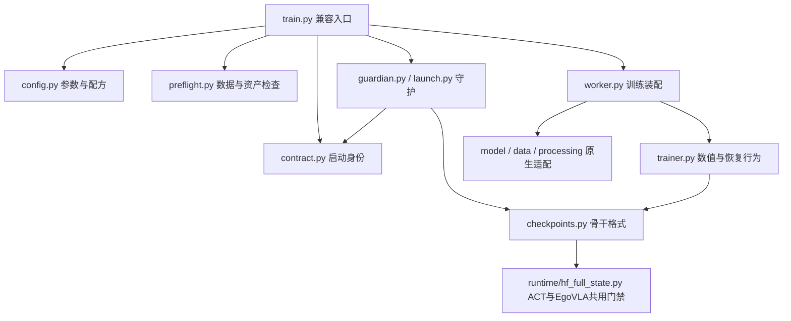

# 训练代码职责整理（2026-10-30）

所属：RHSCI-Private / main，普通目录；起点为本地整合提交 `7c39b9ac9b0285f64596b0ea00e96210dd2009ba`。修改 ACT、π0.5、GR00T、EgoVLA 的训练装配、缓存或断点门禁前必读。用户授权本地结构整理；不自动推送远端。

## 当前职责

四个适配目录 `src/rsci/backbones/{act,pi05,gr00t,egovla}` 采用同一职责划分；每个骨干仍维护自己的配方与原生模型依赖：

| 文件 | 负责内容 |
| --- | --- |
| `train.py` | CLI 流程编排；保留既有模块入口与函数重导出 |
| `config.py` | 参数解析、路径解析、原生 TrainingArguments、学习率/执行选项 |
| `preflight.py` | 数据、资产、通信运行库或已有 run 的前置检查 |
| `contract.py` | 数据/源码/资产/配方身份及契约摘要 |
| `trainer.py` | Trainer 扩展、数值门禁、完整断点回调 |
| `worker.py` | 模型、数据和 Trainer 装配，以及实际 worker 执行 |
| `guardian.py` | π0.5/GR00T/EgoVLA 的重试、进程退出和完整断点恢复 |
| `launch.py` | ACT 的原有守护/日志入口；EgoVLA 的后台启动/日志入口 |

四个 `train.py` 原来分别为 ACT 577、π0.5 617、GR00T 755、EgoVLA 673 行，整理后分别为 81、110、136、129 行。GR00T 的生产 Trainer 和完整断点回调也移到 `trainer.py`；专用于实际 DDP 显存验证的回调留在 worker。推理、资产登记等内部消费者直接依赖 contract/preflight，避免反向依赖训练入口。Ψ0/λ₀ 保留其现有原生集成方式。

## 共用断点门禁的边界

`runtime/hf_full_state.py` 复用 ACT/EgoVLA 的文件清单、模型/Adam 有限性、SHA、完整标记、最新完整点选择和滚动保留策略。各骨干 `checkpoints.py` 显式绑定自己的 schema 和模型载入方法：ACT 仍保存全部模型参数与 buffers，EgoVLA 仍保存可训练权重并绑定固定基础资产；两种标记互不接受。π0.5/GR00T 的分片/原生格式保留独立实现。

验证新点之前不轮换旧点，10k/20k/30k/40k 永久点保留；各 rank RNG 必须齐全。格式整理不授权迁移旧 run：源码契约已经变化，旧目录会拒绝续训，不能改旧契约或清保护标记绕过；旧点继续使用匹配版本和环境。

## 显式缓存配置

`data/cache_config.py` 定义不可变 `InputCacheConfig(root=None, verification="full")`。数据集构造器通过关键字 `cache=` 接收配置；低层缓存工具通过 `config=` 接收配置。不传配置即禁用，不在数据集内读取环境变量。

四个 CLI 新增 `--input-cache-root PATH` 与 `--no-input-cache`，二者互斥；PATH 是包含 `<dataset目录名>/manifest.json` 的缓存父目录。未指定时仅在解析入口兼容旧变量 ACT=`RSCI_ACT_SPACE_CACHE`、π0.5/EgoVLA=`RSCI_INPUT_CACHE`、GR00T=`RSCI_GR00T_INPUT_CACHE`；未设置变量则禁用，显式禁用覆盖环境默认值。

解析后的绝对路径或禁用选项显式传给 guardian/worker。非 worker 使用 `full`（全文件和源视频 SHA），worker 使用 `metadata`（清单、大小和源 stat）；选择不依赖 WORLD_SIZE，也不改变缓存身份字段。通用参数转发识别无参 const 选项，避免把 `--no-input-cache` 当成带路径参数。

去掉旧 `read_manifest` 进程内 LRU：每次开缓存/身份检查重新核清单和 stat，避免同进程重复验收时复用过期检查结果。mmap 像素仍只读、按需打开，增强仍使用复制后的样本。缓存生成器不再通过改写环境变量选择读写路径；它仍复用 ACT 的原生表读取/解码，尚未另建通用 LeRobot schema 层。

## 验证与限制

- 四个 TrainingArguments 函数、π0.5 学习率函数、GR00T 执行配方的移动前后 AST 相同；GR00T 生产 Trainer 和保存回调的 AST 相同。
- π0.5 37 项、GR00T 32 项、ACT 29 项、EgoVLA 28 项 CPU 回归通过。包括真实 CPU Trainer 保存恢复、持久 worker 和 epoch 尾部恢复。
- 新公共断点 3 项、入口/缓存参数 3 项，以及通用训练 CLI 11 项通过；合计 143 项通过。ACT 的 12 项缓存测试包含环境隔离、多卡仍全 SHA、同大小篡改、缺文件及复制保护。
- EgoVLA 全套尝试 29 项，其中 SigLIP 导入测试因当前独立环境缺 `flash_attn` 报错；其余 28 项通过。没有跳过后假称全套通过，也未为此改动训练环境。
- Ruff 0.17.2 全仓维护范围 lint/format 通过（160 文件已格式化）；全仓 Python 语法、Git 空白检查通过。当前源码清单含 1,143 项（加清单本身共 1,144 文件），`check_public_export.py` 返回 `errors=[]`。四个兼容训练入口的真实 `--help` 通过，未启动训练。Ruff 只装在 `/tmp/rhsc-ruff-0172`，实占 25,063,424 bytes；前后范围与预算记录在主树 `Psi0_Image_Storage.md` 和 `/tmp/rhsc-ruff-storage-{before,after}.json`，无持久下载缓存或模型/数据下载。

CPU 套件按原 helper 规则排除分布式测试；未执行全尺寸模型 CUDA 更新、真实多卡训练、吞吐或仿真闭环。没有改动 PSI0-RAW 活动生产代码、配方、进程或 checkpoint；该主树仅追加格式工具占用账本。历史整合来源清单保留原提交的 SHA，当前源码 SHA 由 `PUBLIC_EXPORT_MANIFEST.json` 记录。

本轮机器未安装 Git LFS，`git lfs ls-files` 无法执行；源码导出检查已扫描全部文件，未发现 LFS 指针、模型/数据产物或嵌套 Git。未安装 LFS、未推送远端。
